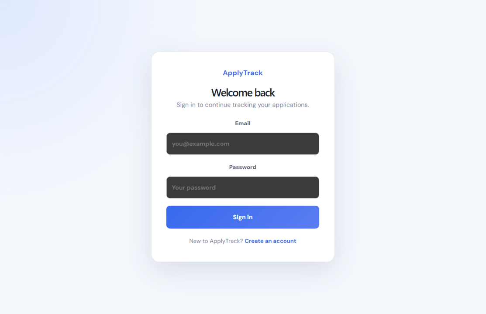
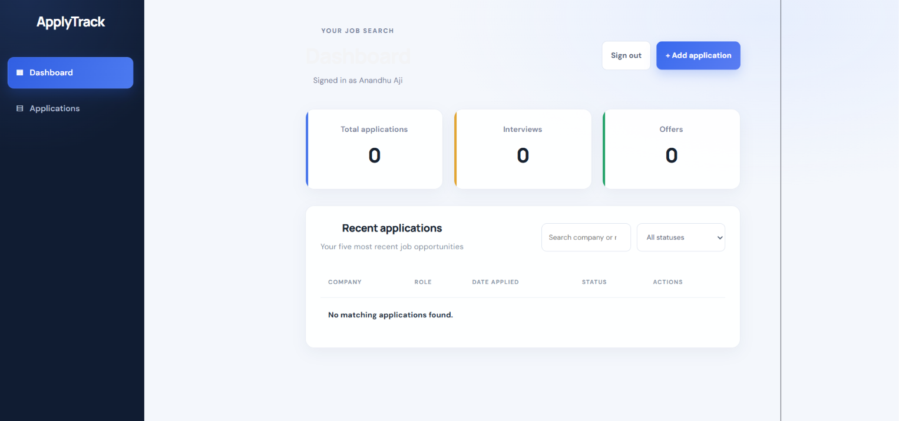
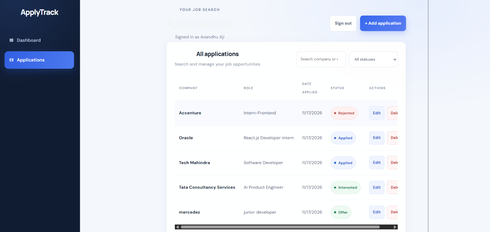
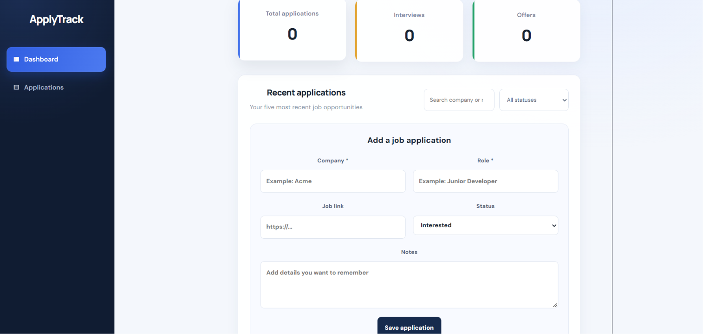

# ApplyTrack

ApplyTrack is a job application tracker built with the MERN stack. It helps users organize applications, track their progress, and manage job details in one place.

## Live Demo

- **Frontend:** [Open ApplyTrack](https://apply-track-1.onrender.com)
- **Backend health check:** [Check the API](https://apply-track-7r2l.onrender.com/api/health)
- **GitHub repository:** [Apply-Track](https://github.com/anandakrishnan8803/Apply-Track)

## Features

- Sign up and log in
- Create, view, edit, and delete job applications
- Track statuses: Interested, Applied, Interview, Offer, and Rejected
- Search applications and filter by status
- View application counts by status on the dashboard
- Responsive layout for desktop and mobile
- Store application data in MongoDB

## Screenshots

### Login



### Dashboard



### Applications



### Application form



## Tech Stack

- **Frontend:** React, Vite, CSS
- **Backend:** Node.js, Express
- **Database:** MongoDB, Mongoose
- **Authentication:** JSON Web Tokens (JWT), bcrypt
- **Deployment:** Render, MongoDB Atlas

## Run Locally

### Requirements

- Node.js and npm
- MongoDB running locally, or a MongoDB Atlas connection string

### 1. Clone the repository

```bash
git clone https://github.com/anandakrishnan8803/Apply-Track.git
cd Apply-Track
```

### 2. Install backend dependencies

```bash
cd server
npm install
```

Create a `server/.env` file with:

```env
PORT=4000
MONGODB_URI=mongodb://127.0.0.1:27017/jobtracker
JWT_SECRET=replace-with-a-private-secret
```

Keep your real secrets private. Do not commit `.env` files to GitHub.

Start the backend:

```bash
npm run dev
```

The backend runs at `http://localhost:4000`.

### 3. Install frontend dependencies

Open a second terminal in the project folder, then run:

```bash
cd client
npm install
```

Create a `client/.env.local` file with:

```env
VITE_API_URL=http://localhost:4000
```

Start the frontend:

```bash
npm run dev
```

Open the local URL shown in the terminal, usually `http://localhost:5173`.

## Environment Variables

| Variable | Used by | Purpose |
|---|---|---|
| `PORT` | Backend | Port used by the Express server |
| `MONGODB_URI` | Backend | MongoDB connection string |
| `JWT_SECRET` | Backend | Secret used to sign authentication tokens |
| `VITE_API_URL` | Frontend | Base URL of the backend API |

## Author

**Anandakrishnan Aji**